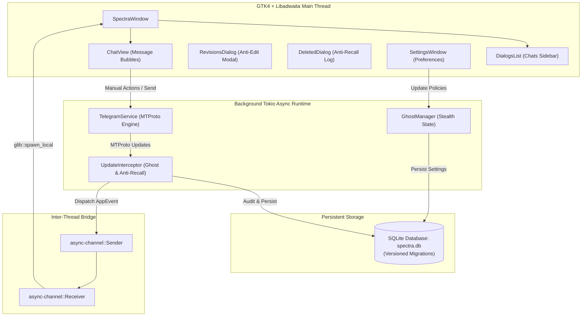

# 👻 Spectra — Native Privacy-Focused Telegram Client

[](LICENSE)
[](https://www.rust-lang.org/)
[](https://gtk.org/)
[-lightgrey.svg)]()

**Spectra** is an independent, high-performance, native Linux Telegram desktop client engineered in pure **Rust**, **GTK4**, and **Libadwaita**, inspired by the privacy innovations of **AyuGram Desktop**.

Built from the ground up without Electron, web wrappers, or bloated runtimes, Spectra gives you total control over what Telegram servers and message senders observe about your activity.

---

## 🛡️ Core Privacy Features (AyuGram Parity)

- 👻 **Ghost Mode (Master Stealth Policy)**:
  - **Suppress Read Receipts**: Read incoming messages, channels, and group chats without dispatching `messages.readHistory` to Telegram servers. Senders never see double checkmarks.
  - **Suppress Typing Indicators**: Draft messages freely without dispatching `messages.setTyping` activity packets.
  - **Block Online Presence**: Prevent the client from reporting user presence (`account.updateStatus(offline=false)`) upon startup, focus, or message drafting.
  - **Anonymous Story Views**: Open and inspect stories without leaving viewer traces (`stories.readStories` suppressed).
- 🚨 **Anti-Recall (Local Message Preservation)**:
  - When a sender deletes a message for everyone (`UpdateDeleteMessages` / `UpdateDeleteChannelMessages`), Spectra **intercepts** the deletion event, tags the message as deleted with the exact timestamp, retains full message text and media metadata in local SQLite storage, and renders it with a red strike-through and a `🚨 DELETED` alert tag.
- ✏️ **Anti-Edit (Chronological Revision History)**:
  - When a message is edited (`UpdateEditMessage`), Spectra archives the prior version in a versioned revisions table before applying the update. Click **"View Revisions"** on any edited message to inspect previous drafts and timestamps.
- 🔓 **Save & Copy Restriction Bypass (`noforwards`)**:
  - Automatically bypasses sender restrictions prohibiting message forwarding, text copying, or media saving in protected groups and channels.
- 🎥 **Streamer Mode**:
  - Automatically redacts sensitive identifiers, phone numbers, secret tokens, and financial balances in both the graphical interface and application log streams.
- 🗑️ **Local History Purge**:
  - Delete any cached conversation or anti-recall history permanently from your local machine with a single click.

---

## 🏗️ Architecture & Technology Stack

Spectra separates asynchronous protocol networking from the GUI main loop:



- **Language**: 100% Rust (stable).
- **GUI**: Native GTK4 (v4.24+) + Libadwaita (v1.10+) conforming to GNOME HIG standards.
- **MTProto Protocol**: Async MTProto via `grammers-client` and `grammers-mtsender`.
- **Database**: SQLite 3 with transactional schema migrations (`schema_version`, `messages`, `message_edits`, `chats`, `settings`).
- **Logging**: Structured, sensitive-redacted logging via `tracing` and `tracing-subscriber`.

---

## 🚀 Building & Running

### Prerequisites

Install the GTK4 and Libadwaita development packages on Debian/Ubuntu/Mint:

```bash
sudo apt update
sudo apt install -y build-essential pkg-config libgtk-4-dev libadwaita-1-dev libssl-dev
```

### Build & Run from Source

```bash
# Clone the repository
git clone https://github.com/rakibulsagor/Spectra.git
cd Spectra

# Run the test suite (unit and integration tests)
cargo test

# Run code quality and clippy verification
cargo fmt --all -- --check
cargo clippy --all-targets --all-features -- -D warnings

# Launch Spectra with demo preview data preloaded
cargo run

# Launch Spectra and connect to a Telegram Bot session
cargo run -- --token "YOUR_BOT_TOKEN" --session "spectra_session.db"
```

---

## 📦 Debian Package Installation (`.deb`)

Spectra includes an automated Debian packaging pipeline in `packaging/`:

### Building the Package

```bash
# Build release binary and package into .deb
cargo build --release
./packaging/build_deb.sh
```

This generates `target/debian/spectra_0.1.0-1_amd64.deb` along with its SHA-256 checksum:

```
2e5afecd49784869880def99efb65a468c298527e8daa4fc5c840e8747e49424  spectra_0.1.0-1_amd64.deb
```

### Installing the Package

```bash
sudo dpkg -i target/debian/spectra_0.1.0-1_amd64.deb
sudo apt install -f  # Resolves any missing runtime dependencies if necessary
```

Once installed, Spectra will appear in your application launcher under **Internet / Chat**, or can be launched from the terminal:

```bash
spectra
```

---

## 📄 Documentation

- [Feature Parity Specification](docs/FEATURE_PARITY.md): Comprehensive feature-by-feature mapping against upstream AyuGram Desktop C++ implementation.

---

## ⚖️ License & Attribution

- **License**: GNU General Public License v3.0 or later ([GPL-3.0-or-later](LICENSE)).
- **Attribution**: Spectra is inspired by the design, reverse engineering insights, and privacy features of [AyuGram Desktop](https://github.com/AyuGram/AyuGramDesktop), originally licensed under GPL-3.0 with OpenSSL exception.
